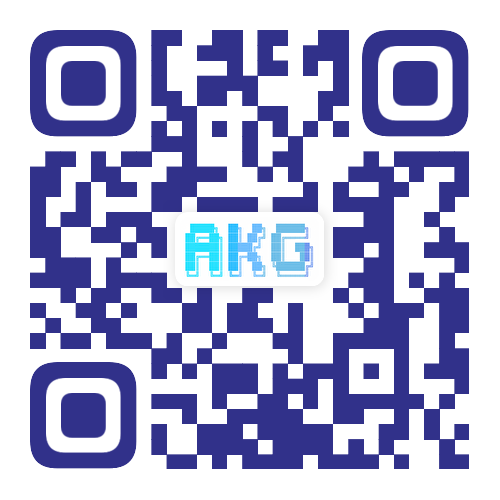

<!-- markdownlint-disable MD033 MD041 -->
<!-- The centered header, navigation anchors, and QR image use HTML for layout and sizing. -->

<div align="center">
  <h1>Device Virtual Machine (DVM)</h1>

[](#akg-sig)
[](#documentation)
[](https://arxiv.org/abs/2603.24239)

  <h3>Microsecond-Scale Compilation &nbsp;·&nbsp; Dynamic Tensor Execution</h3>

  <p><strong>English</strong> | <a href="README.zh.md">简体中文</a></p>

  <p>
    <a href="#quick-start">Quick Start</a>
    &emsp;·&emsp;
    <a href="#documentation">Documentation</a>
    &emsp;·&emsp;
    <a href="include/dvm.h">C++ API</a>
    &emsp;·&emsp;
    <a href="https://arxiv.org/abs/2603.24239">Technical Reports</a>
  </p>
</div>

---

<a id="项目介绍"></a>

## Introduction

DVM (Device Virtual Machine) is currently the industry's only framework for microsecond-scale real-time AI operator
compilation and execution. It compiles and executes handwritten or fused operators in deep neural networks at runtime
based on their concrete shapes. Through real-time compilation, DVM natively supports high-performance operator fusion
and execution in dynamic scenarios, including dynamic shapes and dynamic graphs. DVM also supports conventional
operator optimization scenarios, such as static-shape graph fusion and custom handwritten operators. DVM is currently
used by downstream AI frameworks including [MindSpore](https://gitcode.com/mindspore/mindspore) and
[TorchNPU](https://gitcode.com/Ascend/pytorch) for automatic operator fusion in graph and eager modes.
For most model workloads, this fusion can deliver significant end-to-end performance gains.

DVM supports Huawei Ascend NPU hardware, covering the c220 and c310 chip architectures, as well as NVIDIA GPUs.
The GPU backend supports V100 and newer NVIDIA GPUs.

---

## Core Design

- **Compilation for runtime shapes:** Generate operators using the shapes available at execution time, enabling
  shape-specific optimization for dynamic workloads.
- **Tile-level bytecode:** The host compiler translates operator graphs into tile-level bytecode, which the device
  virtual machine interprets to execute the computation.
- **Fusion across execution modes:** Support operator fusion for static graphs, dynamic shapes, and eager execution,
  with vector and matrix computation.
- **Python and C++ interfaces:** Express custom operators and fused computations through Python or C++, and integrate
  DVM into the compilation and execution paths of downstream frameworks.

See the [operator development guide](docs/tutorial.md) for the architecture and execution flow.

---

<a id="installation"></a>
<a id="环境配置"></a>

## 🛠️ Installation

### Environment requirements

The following requirements and build steps apply to the Ascend backend:

| Component | Requirement |
| --- | --- |
| Operating system | Linux |
| Hardware | Huawei Ascend A2, A3, or A5 |
| Runtime | CANN 8.5 or later |
| C++ compiler | C++17 support; tested with GCC 7.3.0 and Clang 18.1 |
| Python | Python 3.7 or later, with dependencies from [requirements.txt](requirements.txt), including NumPy and pybind11 |

<a id="编译执行"></a>

### Build from source

In an activated Python environment, clone the repository and install its Python dependencies:

```bash
git clone https://github.com/mindspore-ai/dvm.git
cd dvm
python -m pip install -r requirements.txt
```

Replace the CANN path below with your installation path, then configure and build DVM from the repository root:

```bash
source /path/to/ascend-toolkit/set_env.sh
source env.sh
make -j8
python -c "import dvm; print(dvm.__file__)"
```

The build produces `libdvm.a` and `_dvm_py.so`, and copies the Python extension into `python/dvm/`.
The printed import path should point to this checkout. To use Clang for host compilation:

```bash
CXX=clang++ make -j8
```

Development setup, CUDA backend build steps, and testing guidance are in the [Contribution Guide](CONTRIBUTING.md).

---

<a id="quick-start"></a>

## 🚀 Quick Start

### Run a Python example

After building DVM, run the [addition example](examples/01_add.py) from the repository root.
Set `DEVICE_ID` to an available device:

```bash
DEVICE_ID=0 python examples/01_add.py
```

### Use the DVM API

The same example defines an addition kernel with `@dvm.kernel` and executes it on NumPy inputs:

```python
import numpy as np
import dvm


@dvm.kernel
def my_add(k, x, y):
    a = k.load(x, dvm.float32)
    b = k.load(y, dvm.float32)
    c = k.add(a, b)
    d = k.store(c)
    return d


x = np.full([32, 32], 0.1, np.float32)
y = np.full([32, 32], 0.3, np.float32)
z = my_add(x, y)
print(z)
```

More examples cover [batch normalization](examples/02_batchnorm.py), [attention](examples/03_attention.py),
and [matrix multiplication with post-fusion](examples/04_matmul_post_fusion.py).

For C++ applications, include the DVM headers and link `libdvm.a` as shown in the [C++ example](examples/cc/README.md).

For graph-mode and eager-mode fusion in TorchNPU, follow the [integration guide](docs/pytorch.md).

---

<a id="documentation"></a>

## 📖 Documentation

- [Operator Development Guide](docs/tutorial.md) — Architecture, C++ API usage, and execution modes (Chinese)
- [TorchNPU Integration](docs/pytorch.md) — Graph-mode fusion, eager fusion, and custom operators (Chinese)
- [Development Notes](docs/development.md) — Operator restrictions and simulator debugging (Chinese)
- [Examples](examples) — Python kernels and C++ integration
- [C++ API](include/dvm.h) · [Python API](python/dvm/_dvm_py.pyi) — Interface definitions
- [Contributing](CONTRIBUTING.md) — Development setup, testing, pull requests, and review
- [Release Notes](RELEASE.md) — Version history

---

<a id="contributing"></a>
<a id="贡献"></a>

## 🤝 Join Us

Issues and pull requests are welcome, including bug reports, documentation, tests, new operators, and compilation
or execution optimizations. Start with the [Contribution Guide](CONTRIBUTING.md) for development setup, validation,
and the review workflow. Discuss substantial features in an [issue](https://github.com/mindspore-ai/dvm/issues/new/choose)
before implementation.

<a id="akg-sig"></a>
<a id="special-interest-groupsig"></a>

### AKG SIG

If you are interested in DVM's technical direction, scan the QR code below to join the AKG SIG group and discuss
usage and development with the community.



---

<a id="technical-reports"></a>

## 📄 Technical Reports

- DVM: A Bytecode Virtual Machine Approach for Dynamic Tensor Computation [[paper](https://arxiv.org/abs/2603.24239)]

---

<a id="许可证"></a>

## ⚖️ License

[Apache 2.0 License](LICENSE)
