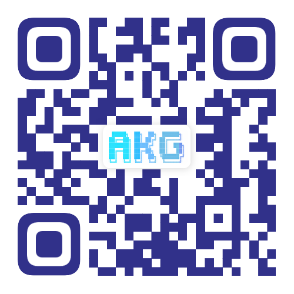

<!-- markdownlint-disable MD033 MD041 -->
<!-- The centered header, navigation anchors, and QR image use HTML for layout and sizing. -->

<div align="center">
  <h1>Device Virtual Machine (DVM)</h1>

[](#akg-sig)
[](#documentation)
[](https://arxiv.org/abs/2603.24239)

  <h3>微秒级实时编译 &nbsp;·&nbsp; 动态张量计算</h3>

  <p><a href="README.md">English</a> | <strong>简体中文</strong></p>

  <p>
    <a href="#quick-start">快速开始</a>
    &emsp;·&emsp;
    <a href="#documentation">文档</a>
    &emsp;·&emsp;
    <a href="include/dvm.h">C++ API</a>
    &emsp;·&emsp;
    <a href="https://arxiv.org/abs/2603.24239">技术报告</a>
  </p>
</div>

---

<a id="项目介绍"></a>

## 简介

DVM（Device Virtual Machine）是当前业界唯一的微秒级实时 AI 算子编译和执行框架，可以实现对深度神经网络中的手写或融合算子在运行时根据具体 Shape 做实时算子编译和执行。
通过实时编译技术，使得 DVM 可以原生支持动态 Shape、动态图等动态网络场景的高性能图算融合和算子执行。
除此之外，DVM 也可以用于静态 Shape 图算融合、自定义手写算子等其它传统算子执行优化场景。
当前，DVM 已应用于 [MindSpore](https://gitcode.com/mindspore/mindspore)、[TorchNPU](https://gitcode.com/Ascend/pytorch) 等多个下游 AI 框架，用于实现图模式或 Eager 模式的自动图算融合优化。
对于大部分网络场景，都可获得较为显著的整网融合性能收益。

DVM 支持 Huawei Ascend NPU 硬件，并覆盖 c220、c310 系列芯片架构；同时支持 NVIDIA GPU，支持 V100 及更新型号。

---

## 核心设计

- **面向运行时 Shape 编译：** 根据执行时确定的具体 Shape 生成算子，为动态场景提供针对 Shape 的优化。
- **Tile 级字节码：** Host 侧编译器将算子计算图转换为 Tile 级字节码，由 Device 侧虚拟机解释执行，完成算子计算。
- **覆盖多种执行模式的融合：** 支持静态图、动态 Shape 和 Eager 模式下的算子融合，涵盖向量与矩阵计算。
- **Python 与 C++ 接口：** 使用 Python 或 C++ 表达自定义算子与融合计算，并接入下游框架的编译和执行流程。

架构与执行流程见[算子开发指南](docs/tutorial.md)。

---

<a id="installation"></a>
<a id="环境配置"></a>

## 🛠️ 安装

### 环境要求

以下环境要求与构建步骤适用于 Ascend 后端：

| 类别 | 要求 |
| --- | --- |
| 操作系统 | Linux |
| 硬件 | Huawei Ascend A2、A3 或 A5 |
| 运行时 | CANN 8.5 或更高版本 |
| C++ 编译器 | 支持 C++17；已验证 GCC 7.3.0 和 Clang 18.1 |
| Python | Python 3.7 或更高版本；安装 [requirements.txt](requirements.txt) 中的依赖，包括 NumPy 和 pybind11 |

<a id="编译执行"></a>

### 源码构建

在已激活的 Python 环境中，获取代码并安装 Python 依赖：

```bash
git clone https://github.com/mindspore-ai/dvm.git
cd dvm
python -m pip install -r requirements.txt
```

将以下 CANN 路径替换为实际安装路径，然后在仓库根目录配置环境并构建 DVM：

```bash
source /path/to/ascend-toolkit/set_env.sh
source env.sh
make -j8
python -c "import dvm; print(dvm.__file__)"
```

构建会生成 `libdvm.a` 和 `_dvm_py.so`，并将 Python 扩展复制到 `python/dvm/`。
输出的导入路径应指向当前代码目录。如需使用 Clang 编译 Host 代码：

```bash
CXX=clang++ make -j8
```

开发环境、CUDA 后端构建步骤和测试说明见[贡献指南](CONTRIBUTING.zh.md)。

---

<a id="quick-start"></a>

## 🚀 快速开始

### 运行 Python 示例

完成 DVM 构建后，在仓库根目录运行[加法示例](examples/01_add.py)。通过 `DEVICE_ID` 选择可用设备：

```bash
DEVICE_ID=0 python examples/01_add.py
```

### 使用 DVM API

该示例通过 `@dvm.kernel` 定义加法 Kernel，并传入 NumPy 数组执行：

```python
import numpy as np
import dvm


@dvm.kernel
def my_add(k, x, y):
    a = k.load(x, dvm.float32)
    b = k.load(y, dvm.float32)
    c = k.add(a, b)
    d = k.store(c)
    return d


x = np.full([32, 32], 0.1, np.float32)
y = np.full([32, 32], 0.3, np.float32)
z = my_add(x, y)
print(z)
```

更多示例包括 [BatchNorm](examples/02_batchnorm.py)、[Attention](examples/03_attention.py)
和 [MatMul 后融合](examples/04_matmul_post_fusion.py)。

C++ 应用需包含 DVM 头文件并链接 `libdvm.a`，具体见 [C++ 示例](examples/cc/README.md)。

在 TorchNPU 中使用图模式或 Eager 模式融合，请参考[接入指南](docs/pytorch.md)。

---

<a id="documentation"></a>

## 📖 文档

- [算子开发指南](docs/tutorial.md) — 架构、C++ API 使用与执行模式
- [TorchNPU 接入指南](docs/pytorch.md) — 图模式融合、Eager 融合与自定义算子
- [开发技巧](docs/development.md) — 算子限制与仿真调试
- [示例](examples) — Python Kernel 与 C++ 集成
- [C++ API](include/dvm.h) · [Python API](python/dvm/_dvm_py.pyi) — 接口定义
- [社区贡献](CONTRIBUTING.zh.md) — 开发环境、测试、PR 提交与评审
- [版本说明](RELEASE.md) — 版本变更记录

---

<a id="contributing"></a>
<a id="贡献"></a>

## 🤝 加入我们

欢迎提交 Issue 和 Pull Request，参与问题反馈、文档、测试、新算子及编译和执行性能优化。
开发环境、验证与评审流程见[贡献指南](CONTRIBUTING.zh.md)。
较大特性请先通过 [Issue](https://github.com/mindspore-ai/dvm/issues/new/choose) 讨论方案，再开始实现。

<a id="akg-sig"></a>
<a id="special-interest-groupsig"></a>

### AKG SIG

如果对 DVM 的技术方向感兴趣，欢迎扫描下方二维码加入 AKG SIG 群，与社区开发者交流使用经验和开发方案。



---

<a id="technical-reports"></a>

## 📄 技术报告

- DVM: A Bytecode Virtual Machine Approach for Dynamic Tensor Computation [[论文](https://arxiv.org/abs/2603.24239)]

---

<a id="许可证"></a>

## ⚖️ 许可证

[Apache 2.0 许可证](LICENSE)
